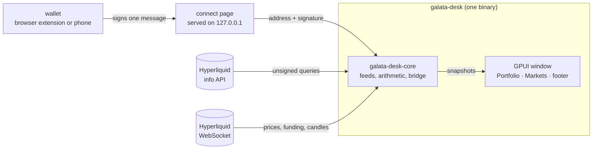

<picture>
  <source media="(prefers-color-scheme: dark)" srcset="assets/logo-on-dark.svg">
  
</picture>

# galata-desk

[](LICENSE-MIT)
[](rust-toolchain.toml)
[](https://github.com/longbridge/gpui-kit)
[](#quick-start)

**A native desktop view of a Hyperliquid account and the markets it trades.
Read-only, and it never holds a key.**

galata-desk shows what one Hyperliquid account is worth, how it has
performed, what it holds and what orders it has resting, beside a live heatmap
of the markets you choose to watch. It learns which account to show by having
you prove, with a wallet in your browser, that you own the address. After
that it only reads public data.

> **Status: 0.x.** macOS only. The Portfolio, Markets and Funding sections, the account
> footer and the wallet connection are built. It places no orders, and is not
> meant to yet.

---

## Contents

- [Where it fits in Galata](#where-it-fits-in-galata)
- [What it shows](#what-it-shows)
- [Screenshots](#screenshots)
- [Quick start](#quick-start)
- [Connecting an account](#connecting-an-account)
- [How the figures are defined](#how-the-figures-are-defined)
- [Configuration](#configuration)
- [Architecture](#architecture)
- [Development](#development)
- [A packaged app](#a-packaged-app)
- [Not built](#not-built)
- [Licence](#licence)

---

## Where it fits in Galata

Galata is a low-latency algorithmic trading framework in Rust.
[galata-datawatch](https://github.com/sercanatalik/galata-datawatch) records
market data, [galata-tower](https://github.com/sercanatalik/galata-tower) is
the operator's window onto that record,
[galata-vault](https://github.com/sercanatalik/galata-vault) keeps its
secrets, and galata-research studies it. galata-desk is the first screen on
the trading side: it looks at an account, live, straight from the venue.

It depends on none of its siblings and needs none of them running.



| It talks to | For | Never |
|---|---|---|
| Hyperliquid's info API | the account's state and history, candle history | sends a signed request |
| Hyperliquid's WebSocket | live market figures and candles | sends anything but subscribe, unsubscribe and ping |
| your wallet, through a local page | one signature proving you own the address | sees a key, or asks for a transaction |

---

## What it shows

### Portfolio

- **Account value**, 14-day volume, and taker and maker fee rates for
  perpetuals or spot.
- **A breakdown**: PNL, volume and max drawdown over 24 hours, 7 days, 30
  days or all time, for the whole account or perpetuals only; and total,
  spot, perpetuals and vault equity, and the staking balance.
- **A history chart** of account value or PNL.
- **Positions** on every perpetuals dex, including builder-deployed ones such
  as `xyz`; **balances**; and **open orders**.

### Markets

The markets you watch, as a grid of tiles under a panel for the one you have
selected. Each tile has the ticker and its dex, an amber dot when you hold a
position in it, the last price, the signed change over the period, and
volatility over the period.

- **Market panel**: click a tile, or press Enter or Space while it is
  focused, to select its market. Pointing at a tile selects nothing. The
  panel stays above the tiles and shows the selected market:
  - on the left, its last price and change, mark and oracle price, premium,
    funding per hour and as a yearly rate, 24-hour volume, open interest, the
    period's low and high, volatility, and your position if you have one;
  - on the right, a candlestick chart over the period (1-minute candles up
    to 1 hour, 15-minute for 24 hours, 2-hour for 7 days) with a line at the
    last price. Point at a candle for its time, open, high, low and close.

  The chart is drawn from the same candles the tiles are computed from. For
  a period under an hour it shows the last hour, so there is something to
  read. The selected market is remembered between launches.

- **Period**: one menu for the whole section, tiles and chart alike: 3, 5,
  15 or 30 minutes, 1 hour, 24 hours or 7 days.
- **Sort**: watchlist order, change (gainers or losers first), volatility,
  funding, or name. Sorting only changes the order tiles are drawn in, and
  the order is held for a few seconds at a time so tiles do not jump on every
  tick. Markets without the figure yet go last.
- **Colour by**: change, volatility, or funding (blue where longs pay, orange
  where shorts pay). A legend above the grid shows the scale.
- **Watchlist**: **+ Add market** lists every perpetual market Hyperliquid
  has, on the main dex and on builder dexes, with a search field. Remove a
  market with the `×` on its tile, or with Delete while it is focused. It
  holds up to 40 markets, is remembered between launches, and starts from the
  markets you hold positions in.

### Funding

What your open positions pay and earn in funding, the hourly charge for
holding a perpetual position.

- **Summary**: net funding per hour and per day at current rates, funding
  since your open positions were opened, and how many positions earn and how
  many pay.
- **Table**: one row per position, largest flow first: size, position value,
  the market's current hourly rate and that rate over a year, what the
  position pays or earns per hour and per day, and its funding since it
  opened.

A plus is funding you receive and a minus funding you pay. The per-hour and
per-day figures assume the current rate and position size hold. Rates are
refreshed once a minute.

### Settings

**Settings**, at the right of the title bar, is there with or without a
connected account.

- **Use testnet** switches everything the app shows to Hyperliquid's test
  network, which has test funds. It takes effect at once and is remembered.
  While it is on, a **TESTNET** badge shows beside the logo on every screen.
- **API key**: the private key of an API wallet you created on Hyperliquid,
  one for mainnet and one for testnet. The page shows the wallet's address,
  derived from the key, so you can check it against the one Hyperliquid
  shows. The key itself is not shown again, and **Remove** deletes it.

A saved key is only stored. Nothing uses it yet, and the app still places no
orders.


A line along the bottom of the window, under every section: equity,
unrealised PNL and its share of equity, PNL over 24 hours and all time, the
number of open positions, the margin they use as a share of equity, and when
the figures were last refreshed.

### Throughout

- Gains are blue and losses orange, and every signed figure carries its `+`
  or `-`, so colour is never the only cue.
- Until a figure arrives its place holds a placeholder, never a zero.
- When Hyperliquid stops answering, the last figures stay on screen, marked
  with the time they are from, and the app keeps retrying.

---

## Screenshots

The account shown is one of Hyperliquid's own public vaults.

| | |
|---|---|
|  |  |
| **Portfolio.** Summary, breakdown, history chart and the positions table, with the footer beneath. | **Markets.** The panel on a builder-dex market, above tiles coloured by 24-hour change. |


**The connect page**, as the app serves it to your browser.

---

## Quick start

You need macOS and a Rust toolchain. `rust-toolchain.toml` pins stable
1.98.1, which `rustup` installs by itself.

```sh
git clone https://github.com/sercanatalik/galata-desk
cd galata-desk
cargo run -p galata-desk
```

Press **Connect wallet**, pick a wallet in the page that opens, sign the
message, and the portfolio appears. The first build takes a few minutes.

To install it as a double-clickable app, see [A packaged app](#a-packaged-app).

---

## Connecting an account

galata-desk never asks for a private key, a seed phrase or an API key. It
needs one thing: an address, and proof that it is yours.

1. Press **Connect wallet**. The app opens a page in your default browser. The
   page is served by the app itself, on `127.0.0.1`, for this one attempt.
2. Pick a wallet.
   - **Browser extensions** (Rabby, MetaMask, any wallet that announces itself
     to the page) are listed by name. Nothing needs configuring.
   - **Phone wallets** (MetaMask or Rabby on iOS, and others) connect by
     scanning a WalletConnect QR code. This needs a relay project id; see
     [Configuration](#configuration).
3. The wallet asks you to sign a short plain-text message. Signing it proves
   you own the address. It is not a transaction, costs nothing, and grants no
   permission to trade or move funds. The message reads:

   ```text
   galata-desk wants to show the Hyperliquid portfolio of this account.

   Signing proves you own the address. It grants no permission to trade or move funds.

   Address: 0x...
   Nonce: <random, new for every attempt>
   Issued: <time>
   ```

4. The app checks the signature on your machine, shows the portfolio, and the
   page says you can close the tab.

An attempt that is not finished in five minutes expires. The app remembers
the address between launches and does not ask again until you **Disconnect**.

Connect with the account that holds the funds. An API wallet (agent) address
has no portfolio of its own, and the venue answers for it with an empty one.

---

## How the figures are defined

Most figures are Hyperliquid's own. These are the ones the app works out, or
where a choice was made.

| Figure | Definition |
|---|---|
| **Total equity** | Depends on how the account holds collateral, which the app asks the venue. With separate perpetuals and spot accounts: perpetuals + spot + vaults. With a unified or portfolio-margin account, where perpetuals are margined from the spot balance: spot + vaults, because the perpetuals figure is already part of spot. |
| **Mark price** (positions) | Position value divided by size; the venue reports both. |
| **Max drawdown** | The largest fall in PNL from an earlier peak, divided by the account value at that peak, over the venue's history for the period. |
| **Unrealised PNL** (footer) | The sum over open positions. |
| **Last price** (markets) | The venue's mid price, or its mark where there is no mid. |
| **Change** (markets) | Last price against the price at the start of a rolling window ending now. The venue's own page measures from the previous day's price, so its 24-hour percentage differs. |
| **Volatility** (markets) | The sample standard deviation of the returns between consecutive candle closes in the period, scaled to the whole period. Not annualised: `3.0%` over 24 hours reads as "it typically moved about 3% in a day". |
| **Funding (yearly)** | The hourly rate times 24 × 365. |

A period is built from candles: 1-minute for 1 hour, 15-minute for 24 hours,
2-hour for 7 days.

---

## Configuration

Nothing needs configuring to use browser-extension wallets.

### Network and API keys

See [Settings](#settings). The network choice is in `settings.json`; API keys
are in the macOS Keychain under `dev.galata.desk`.

A development build is unsigned, so after rebuilding it macOS may ask for
your login password before the app can read a key an earlier build saved.
The packaged app does not have this.

### Phone wallets: the relay project id

WalletConnect's relay requires a project id. It is free, and it is not a
secret: every site that uses WalletConnect ships its own in its page.

1. Create a project at <https://dashboard.reown.com>. No domain needs adding:
   pages on `127.0.0.1` are always permitted.
2. Give the id to galata-desk in either of two ways. The environment variable
   wins when both are set.

   ```toml
   # ~/Library/Application Support/galata-desk/config.toml
   reown_project_id = "your-project-id"
   ```

   ```sh
   export GALATA_DESK_REOWN_PROJECT_ID=your-project-id
   ```

Without an id the page still connects browser extensions, and says how to
enable phone wallets where the QR option would be.

### What is stored

Everything is in `~/Library/Application Support/galata-desk/`:

| File | Holds |
|---|---|
| `account.json` | The connected address and when it was proven. Readable only by you. **Disconnect** deletes it. |
| `watchlist.json` | The watched markets, in order, and which is selected: tickers and dex names. |
| `settings.json` | The network in use: mainnet or testnet. |
| `config.toml` | Optional. The relay project id. |

No key, seed phrase or wallet session is ever written to these files. An API
key you save in Settings is kept in the macOS Keychain, not here.

---

## Architecture

Two crates and a web page.

```text
crates/galata-desk-core/   no UI: venue client, arithmetic, feeds, bridge, store
crates/galata-desk/        the GPUI app: theme, Portfolio, Markets, footer
connect/                   the connect page (TypeScript, built to connect/dist)
```

### The core links no UI

Everything that can be tested without a window lives in `galata-desk-core`:
decoding the venue's answers, every figure's arithmetic, the refresh
schedules, the connection bridge and the signature check. It runs on a Tokio
runtime the app owns, and hands the window snapshots over channels. A GPUI
upgrade or compile failure cannot block its tests.

### Connecting: a browser page, served locally

Rabby and MetaMask on the desktop are browser extensions, and a native
process cannot call them. So the app serves a page:

- It binds `127.0.0.1` on a port the system picks, for one attempt, and stops
  on success, on cancel, and after five minutes.
- Every API call must carry a one-time token from the URL, name this server as
  its `Host`, and come from it as `Origin`. A page elsewhere, or a hostname
  rebound to loopback, is refused.
- The page finds extensions through EIP-6963 and uses WalletConnect's provider
  only for the QR path. Its scripts, styles and fonts come from the app; a
  Content-Security-Policy allows connections only to itself and WalletConnect.
- The wallet signs the challenge with `personal_sign`. The app rebuilds the
  text, recovers the signer and compares addresses. The nonce lives only for
  the attempt, so an old signature proves nothing to a new one.

The page is built to `connect/dist`, which is committed and embedded in the
binary, so building the app needs no Node toolchain.

### Portfolio: tiered polling

| Tier | Every | Asks |
|---|---|---|
| holdings | 5 s | perpetuals state of each dex the account is on, spot balances |
| orders | 10 s | resting orders on each such dex |
| overview | 60 s | history, fees, vaults, staking, and a sweep of every dex |

Only dexes where the account has something are asked every few seconds; the
sweep finds them. A tier that fails keeps its last data. HTTP 429 doubles
every interval, and each later success halves it back.

### Markets: WebSocket, with history on a budget

- One connection carries two subscriptions per watched market: its live
  figures and its current candle. It pings, detects a dead line, reconnects
  with backoff, and puts every subscription back.
- The stream sends only the candle being formed, so the candles before it are
  loaded over REST once per market and period, rationed: five at once, then
  about eleven a minute. A full watchlist of 40 fills in over about three
  minutes.
- A market is subscribed to only once the venue's list of markets shows it
  exists. Hyperliquid closes the whole connection on a subscription to a
  market it does not list, so one delisted market would otherwise take every
  tile offline.
- A silence longer than one candle, such as a laptop asleep, leaves a hole in
  history. The feed measures silence from the last message it received and
  reloads history when that is too long.

### Staying inside the venue's limits

Hyperliquid allows 1,200 request-weight a minute per IP address, shared with
anything else on that address, such as galata-datawatch. Measured with a full
40-market watchlist: 840 in the app's first minute, about 280 a minute once
history has loaded, and no rate-limit answers.

The test network lists hundreds of dexes where the main network has about a
dozen. There the app looks for positions on every dex in batches, every ten
minutes, and looks for open orders only on dexes where the account already
has a position or balance. The first load takes about ten seconds.

---

## Development

```sh
cargo run -p galata-desk                 # the app
cargo test --workspace                   # 183 tests, none needs a network
cargo clippy --workspace --all-targets -- -D warnings

# One account's portfolio from the live venue, in the terminal:
cargo run -p galata-desk-core --example portfolio -- 0x<address>

# Live market tiles in the terminal (1h, 24h or 7d; default 24h):
cargo run -p galata-desk-core --example markets -- --period 7d BTC xyz:NVDA

# One connection attempt, without the app:
cargo run -p galata-desk-core --example connect
```

The core's tests run against recorded venue answers, a scripted market
stream, and an in-process WebSocket server. The app's tests drive real clicks
in a headless window.

After changing the connect page, rebuild it and commit `connect/dist`:

```sh
cd connect && pnpm install && pnpm build
```

### Switches

All are environment variables, and none is needed in normal use.

| Variable | Effect |
|---|---|
| `GALATA_DESK_DIR` | Use this directory instead of the application data directory. |
| `GALATA_DESK_INFO_URL` | Ask this info endpoint instead of Hyperliquid's. |
| `GALATA_DESK_WS_URL` | Use this WebSocket endpoint for market data. |
| `GALATA_DESK_SIZE` | Open the window at this size, for example `1100x700`. |

### Rendering the window to a file

Checking a layout normally needs screen-recording permission. The `shot`
feature renders the window offscreen to a PNG and quits, with the window
hidden:

```sh
cargo build -p galata-desk --features shot
GALATA_DESK_SHOT=/tmp/desk.png \
GALATA_DESK_SHOT_AFTER_MS=5000 \
GALATA_DESK_SHOT_STATE=section=markets,sort=gainers,select=xyz:NVDA \
  ./target/debug/galata-desk
```

`GALATA_DESK_SHOT_STATE` sets the selections to open with. A plain
`cargo run` afterwards rebuilds the binary without the feature.

---

## A packaged app

The icon is the family's Galata Tower mark on a dark tile: `assets/icon.svg`,
with `assets/icon.png` and `assets/AppIcon.icns` rendered from it. The running
app sets it as its Dock icon, so it shows under `cargo run` too.

To build a double-clickable app with the icon in Finder and Launchpad:

```sh
./scripts/bundle-macos.sh        # writes target/bundle/Galata Desk.app
open "target/bundle/Galata Desk.app"
```

The bundle is signed ad hoc, which is enough to run it on the machine that
built it. Distributing it would need a real signing identity.

---

## Not built

- **Trading.** No order entry and no transfers. An API key can be saved in
  Settings, and nothing uses it yet.
- **History tabs**: trade history, funding history, TWAP.
- **Spot markets** in the Markets section, tiles sized by volume, and alerts.
- **Windows and Linux.** GPUI runs there; this app has only been built and
  run on macOS.
- **Smart-contract wallets.** Ownership is proven by recovering a signature,
  so an address that signs through a contract cannot connect.

---

## Licence

MIT. See [LICENSE-MIT](LICENSE-MIT).

The embedded fonts, Instrument Sans and JetBrains Mono, are under the SIL
Open Font License; their licences are in `assets/fonts/`.
