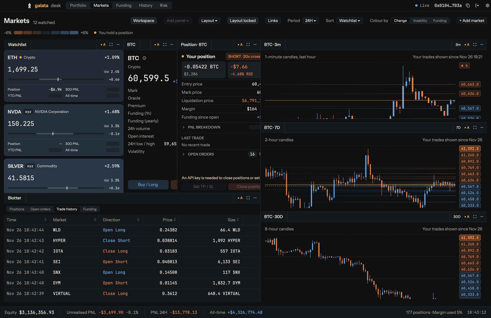

<picture>
  <source media="(prefers-color-scheme: dark)" srcset="assets/logo-on-dark.svg">
  
</picture>

# galata-desk

[](LICENSE-MIT)
[](#quick-start)

**A native macOS desktop for one Hyperliquid account: portfolio, markets,
funding and history, with orders and positions you can manage from the same
window.**

> **Status: 0.x, macOS only.** Documentation: [the book, in `docs/`](docs/src/SUMMARY.md).



Markets in fullscreen: a workspace you arrange, linked by channel. The account
shown is one of Hyperliquid's own public vaults.

## Quick start

You need macOS and Rust (`rust-toolchain.toml` pins the version).

```sh
git clone https://github.com/sercanatalik/galata-desk
cd galata-desk
cargo run -p galata-desk
```

Press **Connect wallet**, pick a wallet in the page that opens and sign the
message. It is not a transaction and grants no permission to trade.

## Trading safeguards

- Trading needs an API wallet key, saved in **Settings** and kept in the macOS
  Keychain. Nothing is sent until you confirm, and mainnet also needs **Allow
  trading on mainnet**, off by default.
- Every action passes one gate in the core (`trade::gate`) that checks the
  network, the key and that the key is an approved API wallet of the account.
- Position closes are reduce-only. The app never retries an order on its own.

## In the book

[Portfolio](docs/src/portfolio.md) · [Markets](docs/src/markets.md) · [Funding](docs/src/funding.md) ·
[History](docs/src/history.md) · [Risk](docs/src/risk.md) · [Watcher](docs/src/watcher.md) ·
[Trading](docs/src/trading.md) · [Settings and storage](docs/src/settings.md) ·
[Development](docs/src/development.md) · [Not built yet](docs/src/roadmap.md)

Part of the Galata trading framework, alongside
[galata-datawatch](https://github.com/sercanatalik/galata-datawatch),
[galata-tower](https://github.com/sercanatalik/galata-tower),
[galata-vault](https://github.com/sercanatalik/galata-vault) and
[galata-watcher](https://github.com/sercanatalik/galata-watcher). It depends on none of them.

## Licence

MIT. See [LICENSE-MIT](LICENSE-MIT). Embedded fonts (Instrument Sans,
JetBrains Mono) are under the SIL Open Font License.
