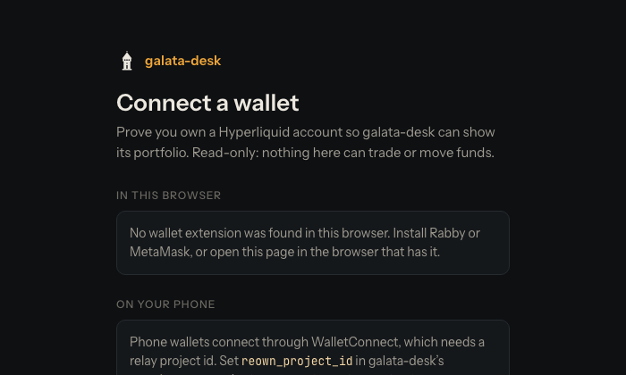

# Getting started

## Build and run

You need macOS and Rust. `rust-toolchain.toml` pins the version, and `rustup`
installs it for you.

```sh
git clone https://github.com/sercanatalik/galata-desk
cd galata-desk
cargo run -p galata-desk
```

The first build takes a few minutes.

## Connect an account

galata-desk never asks for a seed phrase or a private key to connect.

1. **Connect wallet** opens a page the app serves on `127.0.0.1` for this one
   attempt.
2. Pick a browser-extension wallet (Rabby, MetaMask and others are found
   automatically). Phone wallets connect by WalletConnect QR code, which
   needs a relay project id (see [Settings](settings.md#phone-wallets)).
3. Sign a plain-text message. It is not a transaction, costs nothing, and
   grants no permission to trade.



The app checks the signature locally and remembers the address until you
**Disconnect**. Connect the account that holds the funds: an API wallet's
address has no portfolio of its own.

## Reading the screen

- Gains are blue and losses orange, and every signed figure carries a `+` or
  `-`.
- While data is loading, placeholders stand in, never zeros.
- If Hyperliquid stops answering, the last figures stay on screen with their
  time.
- The footer along the bottom of every screen shows equity, unrealised and
  24-hour PNL, the number of positions and the margin they use.

To trade, save an API key first. See [Trading](trading.md).
