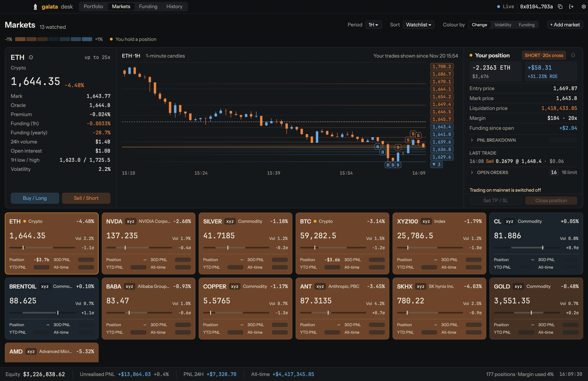
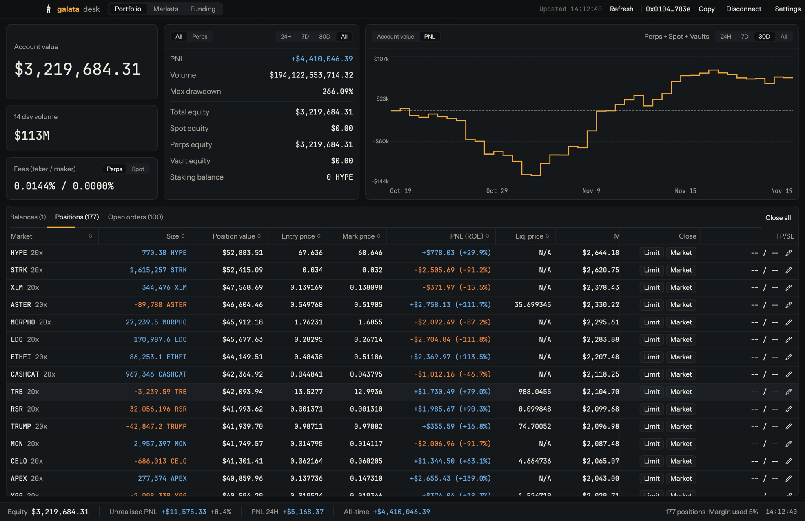

# galata-desk

**A native macOS desktop for one Hyperliquid account: its portfolio, the
markets it trades and the funding it pays, with orders and positions you can
manage from the same window.**

You prove you own an address by signing a message in your browser wallet.
From then on the app reads public data. It signs nothing unless you save an
API key and confirm an action.

The account shown is a public Hyperliquid vault.

## Status

0.x, macOS only. It can place orders from the Markets section, amend and
cancel them, close positions, and set their take-profit and stop-loss.

## Part of Galata

Galata is a Rust trading framework. Its siblings record market data
([galata-datawatch](https://github.com/sercanatalik/galata-datawatch)), watch
that record ([galata-tower](https://github.com/sercanatalik/galata-tower)),
keep its secrets ([galata-vault](https://github.com/sercanatalik/galata-vault))
and send alerts while the desk is closed
([galata-watcher](https://github.com/sercanatalik/galata-watcher)).
galata-desk depends on none of them.

The source is on [GitHub](https://github.com/sercanatalik/galata-desk), under
the MIT licence.
