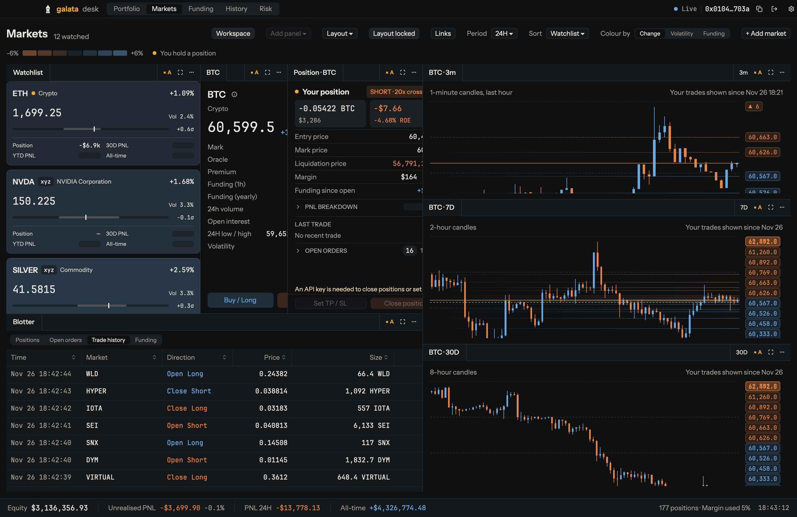

# Markets

## Tiles

A heatmap of the markets you watch, up to 40. **+ Add market** adds one.

- Each tile shows the last price, the change and volatility over the period
  you pick (3 minutes to 7 days), and a dot when you hold a position there.
- A held market's tile also shows the position's value and its 30-day,
  year-to-date and all-time PNL.
- Tiles sort by change, volatility, funding or name, and are coloured by
  change, volatility or funding.

Selecting a tile opens the panel above the tiles: market details on the left,
the chart in the middle and your position on the right.

## Market details

Price and change, mark and oracle price, premium, hourly and yearly funding,
24-hour volume, open interest, the period's low and high, volatility and the
maximum leverage. **Buy / Long** and **Sell / Short** open the
[order ticket](trading.md#order-ticket).

## Chart

A candlestick chart over the selected period.

- Your own fills are marked **B** where you bought and **S** where you sold.
- Your resting orders are tagged at their prices on the right.
- While you hold a position, a dashed line marks its entry price, labelled
  with the price and the signed size.
- With a [watcher](watcher.md) connected, its armed call levels are dashed
  amber lines tagged **Alert**.

Right-clicking the chart offers **Alert at** the price under the pointer.
Right-clicking a tile offers **Alert for** that market at its last price.
Cancel, ×, Esc or a click outside closes that form without saving.

## Position panel

The right-hand column shows the account's position in the selected market.

- **Header**: the side (`LONG` or `SHORT`), leverage and margin mode, or
  `Flat`, and a bell for the market's alerts.
- **Size and PNL**: the signed size in the coin with its dollar value, and
  unrealised PNL with the return on equity.
- **Details**: entry, mark and liquidation price, margin with leverage, and
  funding since the position opened.
- **PNL breakdown** (collapsible): realised and total PNL over 24 hours,
  30 days, the year to date and all time. The header shows the 24-hour total.
- **Last trade**: the time, side, size, price and fee of the latest fill in
  this market.
- **Open orders** (collapsible): the count and a summary such as
  `TP · SL · 1 limit`. Expanded, each order shows its side, kind, remaining
  size and price, with a cancel button, and **Cancel all** cancels every
  order in this market only.
- **Set TP / SL** and **Close position** open the same dialogs as the
  Positions tab.

Both collapsible sections start collapsed and keep their state while the app
runs. When trading is not possible, the buttons stay visible but disabled and
one line says why.

### Alerts menu

The bell shows how many armed call levels the watcher holds for the market.
Pressing it opens a menu that:

- lists the market's levels with their price, direction and state;
- adds an armed level at a price you enter, pointing away from the current
  price;
- shows the account-wide stop-alerts switch and near-liquidation distance.

The bell is disabled while no watcher is connected or it cannot be reached.

## Fullscreen workspace

When the window is fullscreen, Markets becomes a workspace you arrange
yourself. Leave fullscreen and the fixed layout returns, showing the market
channel A last showed. The other sections look the same either way.

The **Workspace** switch in the toolbar shows the workspace in a window of
any size, or the fixed layout in fullscreen. Entering or leaving fullscreen
hands the choice back to the window.

### Panels

Every part of the workspace is a panel with a header: its title, its link
channels, **maximise** and **close**. **Add panel** adds one beside the
largest panel:

- **Chart**: a market's candles over its own period. Narrow charts drop the
  price axis rather than cut figures off.
- **Watchlist tiles**: the tiles, with the same colours, sort and figures.
- **Market detail**, with Buy and Sell.
- **Position**: the account's position in a market.
- **Order ticket**: the ticket, docked. There is only ever one; while it is
  there, Buy and Sell fill it in instead of opening it over the screen.
- **Blotter**: Positions, Open orders, Trade history and Funding, as Portfolio,
  History and Funding show them, with the same buttons and confirmations.

Drag a panel by its header onto another panel's edge to split that panel, or
onto its centre to make tabs; Escape cancels. Drag the dividers to resize, down
to 100 points. Closing the last panel leaves an empty workspace that offers
Add panel and the layouts.

### Layouts

**Layout** offers four presets, each replacing the current layout:
**Trader** (two charts, tiles, blotter, position, detail and ticket),
**Focus chart**, **Quad charts** (four equal charts) and **Chart and
blotter**. The first time, the workspace shows Trader.

**Saved layouts…** keeps the current layout under a name, with its panels,
markets, periods and links; choose it from the Layout menu to get it back,
or rename or delete it there. The workspace is remembered across launches.
If the remembered layout cannot be read, the workspace shows Trader and says
so once.

**Lock layout** stops panels being dragged, resized, closed or added. What is
in them works as usual.

### Link channels

Panels share what you do through three channels: **A** (amber square),
**B** (blue circle) and **C** (violet triangle). On each channel a panel is
off, listens, sends, or does both. A panel on no channel is **pinned**: it
keeps its own market.

What a sending panel can tell its channels:

| Action | From | Does |
|---|---|---|
| Set market | Tiles, blotter rows | Listening panels show that market. |
| Sync time cursor | Charts | Listening charts mark the same candle. |
| Limit price from chart | A click on a chart | The listening ticket's limit price becomes that price. |
| Filter blotter | Tiles, blotter rows | Listening blotters show only that market's rows. |

Click a panel's channel marks to set its roles, or open **Links** to see
every panel's roles and switch each sending panel's actions on or off. New
panels start linked on channel A: tiles, blotter and charts send, and the
others listen; filter blotter starts off.

Linking never trades. Nothing linked sends an order, opens a confirmation or
changes an order: at most it fills in a ticket field you could have typed.
