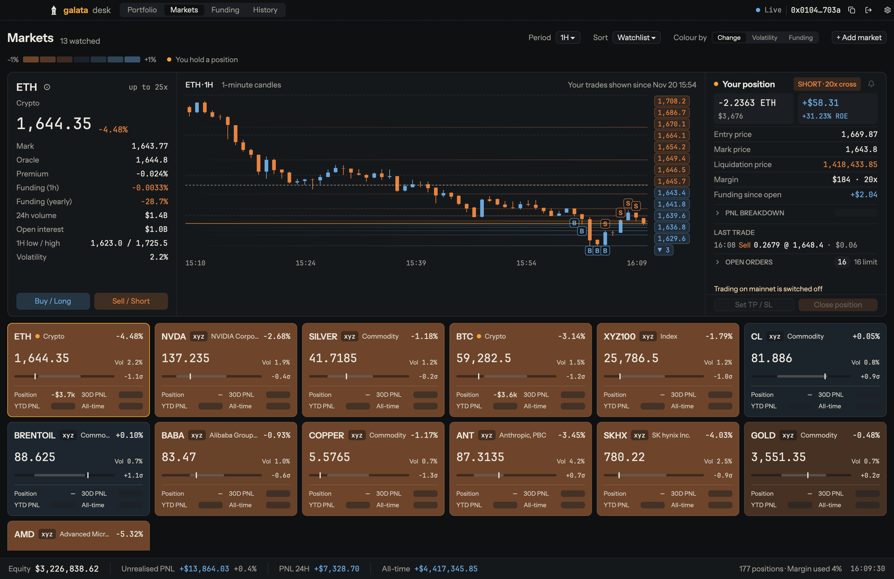

# Markets

## Tiles

A heatmap of the markets you watch, up to 40. **+ Add market** adds one.

- Each tile shows the last price, the change and volatility over the period
  you pick (3 minutes to 7 days), and a dot when you hold a position there.
- A held market's tile also shows the position's value and its 30-day,
  year-to-date and all-time PNL.
- Tiles sort by change, volatility, funding or name, and are coloured by
  change, volatility or funding.

Selecting a tile opens the panel above the tiles: market details on the left,
the chart in the middle and your position on the right.

## Market details

Price and change, mark and oracle price, premium, hourly and yearly funding,
24-hour volume, open interest, the period's low and high, volatility and the
maximum leverage. **Buy / Long** and **Sell / Short** open the
[order ticket](trading.md#order-ticket).

## Chart

A candlestick chart over the selected period.

- Your own fills are marked **B** where you bought and **S** where you sold.
- Your resting orders are tagged at their prices on the right.
- While you hold a position, a dashed line marks its entry price, labelled
  with the price and the signed size.
- With a [watcher](watcher.md) connected, its armed call levels are dashed
  amber lines tagged **Alert**.

Right-clicking the chart offers **Alert at** the price under the pointer.
Right-clicking a tile offers **Alert for** that market at its last price.
Cancel, ×, Esc or a click outside closes that form without saving.

## Position panel

The right-hand column shows the account's position in the selected market.

- **Header**: the side (`LONG` or `SHORT`), leverage and margin mode, or
  `Flat`, and a bell for the market's alerts.
- **Size and PNL**: the signed size in the coin with its dollar value, and
  unrealised PNL with the return on equity.
- **Details**: entry, mark and liquidation price, margin with leverage, and
  funding since the position opened.
- **PNL breakdown** (collapsible): realised and total PNL over 24 hours,
  30 days, the year to date and all time. The header shows the 24-hour total.
- **Last trade**: the time, side, size, price and fee of the latest fill in
  this market.
- **Open orders** (collapsible): the count and a summary such as
  `TP · SL · 1 limit`. Expanded, each order shows its side, kind, remaining
  size and price, with a cancel button, and **Cancel all** cancels every
  order in this market only.
- **Set TP / SL** and **Close position** open the same dialogs as the
  Positions tab.

Both collapsible sections start collapsed and keep their state while the app
runs. When trading is not possible, the buttons stay visible but disabled and
one line says why.

### Alerts menu

The bell shows how many armed call levels the watcher holds for the market.
Pressing it opens a menu that:

- lists the market's levels with their price, direction and state;
- adds an armed level at a price you enter, pointing away from the current
  price;
- shows the account-wide stop-alerts switch and near-liquidation distance.

The bell is disabled while no watcher is connected or it cannot be reached.
