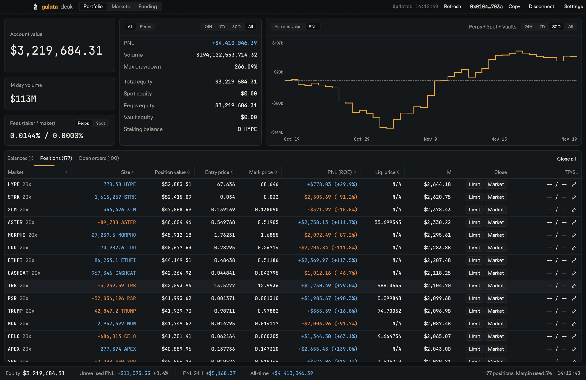

# Portfolio

- Account value, 14-day volume and fee rates.
- PNL, volume and max drawdown over 24 hours, 7 days, 30 days or all time.
- Equity by kind: perpetuals, spot, vaults and staking.
- A chart of account value or PNL.

Below are three tabs:

- **Positions** on every perpetuals dex, including builder dexes such as
  `xyz`, with **Close** and **TP/SL** on each row and **Close all**.
- **Balances**.
- **Open orders**, with **Cancel**, **Cancel all** and **Amend**.

What those controls do is under [Trading](trading.md).
